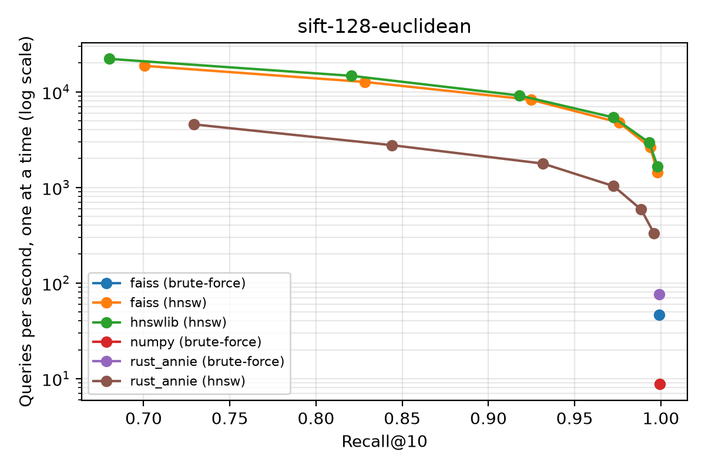

# Benchmarks

`benchmarks/compare.py` compares rust-annie with other k-NN libraries using the
[ANN-Benchmarks](https://ann-benchmarks.com) methodology: standard datasets with
precomputed ground truth, recall@k, and queries issued one at a time. It also reports
batch throughput using all cores, and index build time.

In the one-query-at-a-time column, FAISS and hnswlib are limited to one thread. rust-annie
HNSW search is single-threaded per query, but rust-annie exact search parallelises a
single query across cores once the index holds more than about 500 000 numbers
(e.g. 8 000 vectors of dimension 64); set `RAYON_NUM_THREADS=1` for a strictly
single-threaded comparison.

Libraries compared (each is skipped if not installed):

| Library | Exact | Approximate |
|---|---|---|
| rust-annie | `AnnIndex` | `PyHnswIndex` |
| [FAISS](https://github.com/facebookresearch/faiss) | `IndexFlatL2` | `IndexHNSWFlat` |
| [hnswlib](https://github.com/nmslib/hnswlib) | – | `hnswlib.Index` |
| NumPy | matrix product + `argpartition` | – |

All HNSW implementations use the same `M` and `ef_construction` and are swept over the
same `ef` values. Cosine datasets are L2-normalised for FAISS.

## Reproducing

```bash
pip install rust-annie hnswlib faiss-cpu h5py matplotlib

# quick synthetic check (10 000 x 32, no download)
python benchmarks/compare.py --dataset random-xs

# standard datasets (downloaded once to ~/.cache/rust_annie_bench)
python benchmarks/compare.py --dataset sift-128-euclidean --plot
python benchmarks/compare.py --dataset glove-100-angular --plot
```

Results are written to `benchmarks/results/<dataset>.csv` (first line records the
machine) and, with `--plot`, a recall/QPS plot. Run `--help` for all options
(`--m`, `--ef-construction`, `--ef`, `--k`, `--max-queries`, `--libraries`).

For Rust-level micro-benchmarks run `cargo bench`.

## Results

Results depend strongly on hardware; always report the machine. The tables below were
measured with rust-annie 0.3.0, hnswlib 0.8.0, FAISS 1.15.1 (CPU) and NumPy 2 on an
Intel Core i5-1135G7 laptop (4 cores, 8 threads), Linux, Python 3.14 (Euclidean,
k = 10, HNSW with `M=16`, `efC=200`). QPS is queries per second. The first two tables use
synthetic Gaussian data with 200 queries; the third is the standard SIFT-1M dataset.

`random-xs`: 10 000 × 32

| Library | Method | ef | Recall@10 | QPS (one at a time) | QPS (batch) | Build (s) |
|---|---|---|---|---|---|---|
| rust-annie | exact | – | 1.000 | 12 320 | 54 428 | 0.00 |
| FAISS | exact (`IndexFlatL2`) | – | 1.000 | 12 265 | 64 398 | 0.00 |
| NumPy | exact (BLAS) | – | 1.000 | 6 722 | 7 892 | – |
| rust-annie | HNSW | 80 | 0.985 | 2 930 | 16 745 | 1.08 |
| hnswlib | HNSW | 80 | 0.980 | 21 495 | 106 155 | 0.25 |
| FAISS | HNSW | 80 | 0.984 | 15 606 | 127 325 | 0.47 |

`random-s`: 100 000 × 64

| Library | Method | ef | Recall@10 | QPS (one at a time) | QPS (batch) | Build (s) |
|---|---|---|---|---|---|---|
| rust-annie | exact | – | 1.000 | 1 305 | 1 803 | 0.02 |
| FAISS | exact (`IndexFlatL2`) | – | 1.000 | 727 | 2 760 | 0.00 |
| NumPy | exact (BLAS) | – | 1.000 | 149 | 160 | – |
| rust-annie | HNSW | 320 | 0.909 | 306 | 1 415 | 40.1 |
| hnswlib | HNSW | 320 | 0.913 | 1 748 | 4 808 | 11.1 |
| FAISS | HNSW | 320 | 0.886 | 1 907 | 6 983 | 9.9 |

`sift-128-euclidean` (SIFT-1M): 1 000 000 × 128, 1 000 queries, same machine and settings

| Library | Method | ef | Recall@10 | QPS (one at a time) | QPS (batch) | Build (s) |
|---|---|---|---|---|---|---|
| rust-annie | exact | – | 0.999 | 76 | 78 | 0.6 |
| FAISS | exact (`IndexFlatL2`) | – | 0.999 | 46 | 758 | 0.2 |
| NumPy | exact (BLAS) | – | 0.999 | 9 | 9 | – |
| rust-annie | HNSW | 40 | 0.932 | 1 773 | 7 720 | 525 |
| hnswlib | HNSW | 40 | 0.918 | 9 147 | 18 699 | 180 |
| FAISS | HNSW | 40 | 0.925 | 8 245 | 19 112 | 194 |
| rust-annie | HNSW | 80 | 0.973 | 1 029 | 4 304 | 525 |
| hnswlib | HNSW | 80 | 0.972 | 5 393 | 10 655 | 180 |
| FAISS | HNSW | 80 | 0.976 | 4 766 | 10 919 | 194 |
| rust-annie | HNSW | 320 | 0.996 | 331 | 1 324 | 525 |
| hnswlib | HNSW | 320 | 0.998 | 1 659 | 3 166 | 180 |
| FAISS | HNSW | 320 | 0.998 | 1 425 | 3 239 | 194 |

Exact recall is slightly below 1 because SIFT contains equidistant neighbours that the
reference ground truth orders differently. The full sweep (`ef` = 10…320) is in
`paper/figures/sift-128-euclidean.png`.



What these show:

- **Exact search, one query at a time:** rust-annie (using all cores) is faster than
  FAISS's flat index on one thread, and 2–9× faster than NumPy.
- **Exact search, batches:** for small indexes rust-annie and FAISS are within about
  ±35 %. For large indexes FAISS is much faster (about 10× on SIFT-1M), because it
  computes a batch of distances as a BLAS matrix product that reuses each vector from
  cache, whereas rust-annie reads the whole index once per query.
- **HNSW search** in rust-annie reaches the same recall as hnswlib and FAISS for the
  same parameters, but is 3–7× slower per query (about 5× on SIFT-1M, 2.5× for
  batches) and builds about 3× more slowly. If HNSW throughput on Euclidean or
  inner-product data is what matters most, use hnswlib or FAISS. rust-annie's HNSW suits
  workloads that need its other features (removal, filters, a shared API with exact
  search) at moderate query rates.
- Random Gaussian data in 64 dimensions is a hard case for graph indexes, which is why
  recall on `random-s` is low at small `ef`; SIFT reaches 0.97 recall at `ef` = 80.